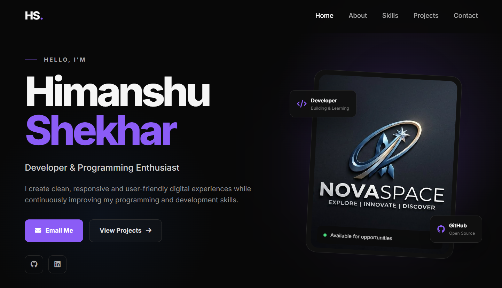

# 🚀 Modern Landing Page

A modern, responsive and professional landing page built with **HTML, CSS and JavaScript**.

The project focuses on clean UI design, smooth navigation, responsive layouts and a polished user experience.

---

## 🌐 Live Demo

🔗 **Live Website:**
https://github.com/nirajchaudhary295/CODSOFT_TASKSNO_2_LANDING-PAGE

---

## 📌 About The Project

This landing page was designed with a focus on:

* Modern and professional UI
* Clean and structured layout
* Responsive design
* Smooth scrolling navigation
* Interactive elements
* Mobile-friendly interface
* Direct Gmail contact functionality
* Professional typography and spacing
* Simple and maintainable code

The project is designed to work smoothly across desktop, tablet and mobile devices.

---

## ✨ Features

### 🎨 Modern UI

Clean, minimal and professional visual design with a modern dark interface.

### 📱 Fully Responsive

The landing page adapts to:

* Desktop
* Laptop
* Tablet
* Mobile

### 🧭 Navigation

Includes smooth navigation between:

* Home
* About
* Skills
* Projects
* Contact

### 📧 Email Integration

The **Email Me** button opens a Gmail compose window directly in the browser.

### 🔗 Social Links

Integrated links for:

* GitHub
* LinkedIn

### 📂 Project Section

A dedicated section for showcasing development projects.

### ⚡ Interactive JavaScript

JavaScript is used for:

* Mobile navigation
* Active navigation highlighting
* Dynamic copyright year
* User interactions

---

## 🛠️ Technologies Used

| Technology   | Purpose                       |
| ------------ | ----------------------------- |
| HTML5        | Website structure             |
| CSS3         | Styling and responsive design |
| JavaScript   | Interactivity                 |
| Font Awesome | Icons                         |
| Google Fonts | Typography                    |
| Git          | Version control               |
| GitHub       | Repository hosting            |
| GitHub Pages | Website deployment            |

---

## 📁 Project Structure

```text
landing-page/
│
├── index.html
├── style.css
├── script.js
├── profile.jpg
└── README.md
```

---

## 🖥️ Getting Started

To run this project locally:

### 1. Clone the repository

```bash
https://github.com/nirajchaudhary295/CODSOFT_TASKSNO_2_LANDING-PAGE

```

### 2. Open the project

```bash
cd landing-page
```

### 3. Run the website

Open `index.html` in your browser.

For the best development experience, use **VS Code with Live Server**.

---

## 📸 Preview



---

## 📧 Contact

If you'd like to connect or discuss a project:

**Email:**
[nirajchaudhary295@gmail.com](mailto:nirajchaudhary295@gmail.com)

**GitHub:**
https://github.com/nirajchaudhary295

**LinkedIn:**
https://www.linkedin.com/in/niraj-chaudhary-26b2a1447

---

## 🔮 Future Improvements

Possible future enhancements include:

* [ ] Add animations and micro-interactions
* [ ] Add more projects
* [ ] Add a contact form
* [ ] Improve accessibility
* [ ] Add more advanced JavaScript interactions
* [ ] Add light/dark theme switching
* [ ] Improve SEO
* [ ] Add performance optimizations

---

## 📄 License

This project is open-source and available for learning and personal use.

---

## ⭐ Support

If you find this project useful or interesting, consider giving the repository a ⭐ on GitHub.

---

### Made with ❤️ using HTML, CSS & JavaScript

**Niraj chaudhary**
